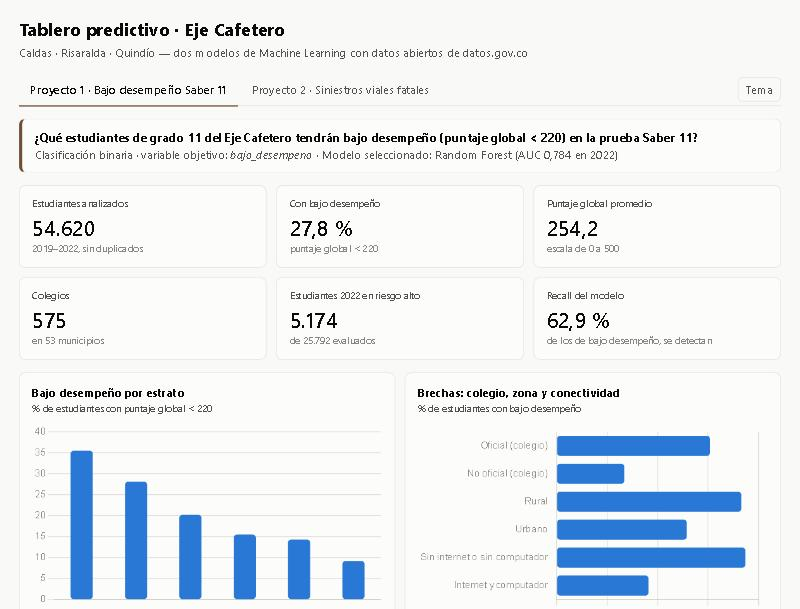
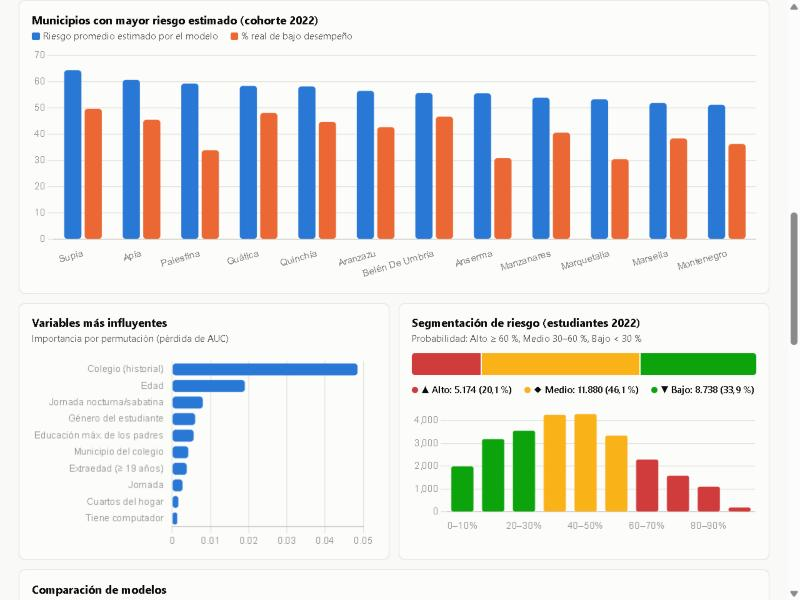
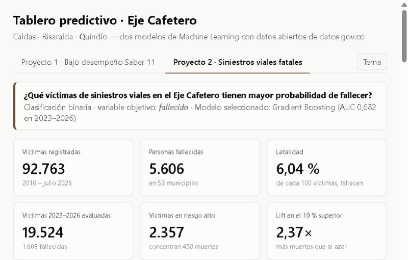

# Alerta temprana con machine learning · Eje Cafetero

Dos modelos predictivos con datos abiertos de Colombia (datos.gov.co) para Caldas, Risaralda y Quindío. Están pensados para que una entidad pública sepa **a quién acompañar primero**:

1. **Saber 11:** ¿qué estudiantes van a sacar un puntaje global bajo (< 220 de 500)?
2. **Siniestros viales:** ¿qué víctimas de un siniestro tienen más probabilidad de morir?

Todo el flujo está en Python: descarga, limpieza, ingeniería de variables, validación temporal, comparación de modelos y un tablero en HTML.

---

## Resultados

### 1. Alerta temprana Saber 11

| | |
|---|---|
| Datos | 54.620 estudiantes de 575 colegios y 53 municipios (ICFES, 2019–2022) |
| Validación | **temporal**: se entrena con 2019–2021 y se prueba con la cohorte 2022 (25.792 estudiantes), como se usaría en la vida real |
| Mejor modelo | Random Forest · **AUC 0,784** en 2022 (AUC 0,803 ± 0,008 en validación cruzada) |
| Utilidad | el 10 % de estudiantes con mayor riesgo concentra el 25 % de los puntajes bajos (**lift 2,5×**) |

| Modelo | AUC CV | AUC 2022 | Precisión | Recall | F1 |
|---|---:|---:|---:|---:|---:|
| Regresión logística | 0,797 | 0,777 | 48,5 % | 64,0 % | 0,552 |
| **Random Forest** | 0,803 | **0,784** | 50,1 % | 62,9 % | 0,558 |
| Gradient Boosting | 0,804 | 0,783 | 48,4 % | 64,6 % | 0,554 |




### 2. Riesgo de muerte en siniestros viales

| | |
|---|---|
| Datos | 92.763 víctimas (Policía Nacional, 2010–2026): 5.606 fallecidos, letalidad del 6,0 % |
| Validación | temporal: entrena 2010–2022, prueba 2023–2026 (19.524 víctimas) |
| Mejor modelo | Gradient Boosting · **AUC 0,682** |
| Utilidad | el 12 % de víctimas marcadas como riesgo alto concentra el **28 % de las muertes** |



---

## Decisiones de datos que cambian el resultado

- **Duplicados en la fuente:** el portal publica dos veces a cada estudiante de los periodos 2019-2 y 2022-2 (55.246 filas para 27.564 estudiantes en 2019-2, verificado con el consecutivo del estudiante). Sin quitarlos, el modelo se evalúa sobre copias y las métricas se inflan.
- **Fuga de información:** los puntajes por área (matemáticas, lectura…) salen el mismo día que el puntaje global, así que no se usan como predictores. En víctimas, "NO REPORTADO" aparecía mucho más en fallecidos (18 %) que en lesionados (4 %); se unificó para que el modelo no aprendiera la forma de registrar en vez del riesgo.
- **Validación temporal y no aleatoria:** el modelo se prueba con años que no vio, como pasaría al usarlo con una cohorte nueva.
- **Nulos con significado:** en las variables familiares, el dato faltante se deja como categoría "Sin información" en vez de imputarlo.

## Límites

- AUC 0,68 en víctimas es moderado: faltan hora, tipo de vía, velocidad y alcohol. La siguiente fase sería cruzar con los informes de tránsito (IPAT).
- Saber 11 usa el historial del colegio, que pesa mucho en la predicción. El modelo sirve para priorizar apoyo, **nunca para excluir o etiquetar a estudiantes o colegios** (Ley 1581 de 2012). Por eso este repositorio no publica listas de colegios con nombre propio.

---

## Cómo correrlo

```bash
pip install -r requirements.txt
python scripts/00_descargar_datos.py     # ~45 MB desde datos.gov.co
python scripts/01_preparacion_datos.py   # limpieza y variables -> data/processed/
python scripts/02_modelado_validacion.py # 3 modelos por proyecto -> outputs/metricas.json
python scripts/03_generar_tablero.py     # outputs/tablero.html
```

Todo corre en cerca de un minuto. La fuente se actualiza, así que las cifras de siniestros viales pueden variar un poco según el día de descarga. En una prueba del 15 nov 2026 con datos recién descargados, Saber 11 dio los mismos 54.620 estudiantes y un AUC de 0,783–0,784; Random Forest y Gradient Boosting quedan a una milésima, así que a veces gana uno y a veces el otro.

## Estructura

```
scripts/
  00_descargar_datos.py      API de datos.gov.co (Socrata)
  01_preparacion_datos.py    limpieza, duplicados, variables derivadas
  02_modelado_validacion.py  regresión logística, Random Forest y Gradient Boosting
  03_generar_tablero.py      tablero HTML con Chart.js
outputs/
  metricas.json              métricas de todos los modelos
  calidad_datos.json         informe de calidad de datos
  img/                       capturas del tablero
```

## Fuentes

- ICFES · Resultados únicos Saber 11 (`kgxf-xxbe`)
- Policía Nacional · Lesiones en accidente de tránsito (`72sg-cybi`)
- Policía Nacional · Homicidios en accidente de tránsito (`ha6j-pa2r`)

---

Daniel Norabuena · Analista de datos · [linkedin.com/in/danielnorabuena](https://www.linkedin.com/in/danielnorabuena)
